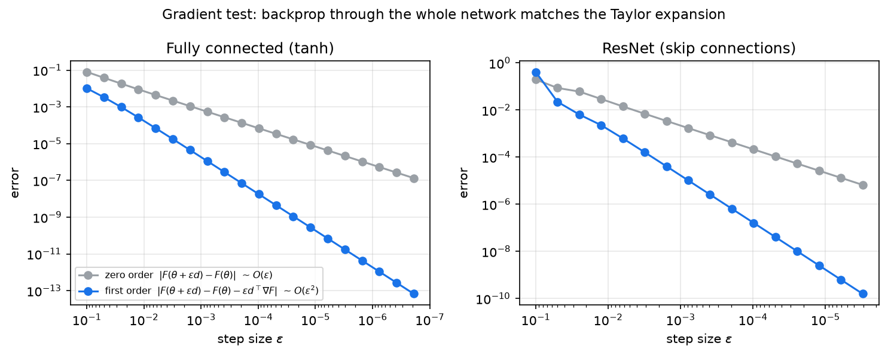
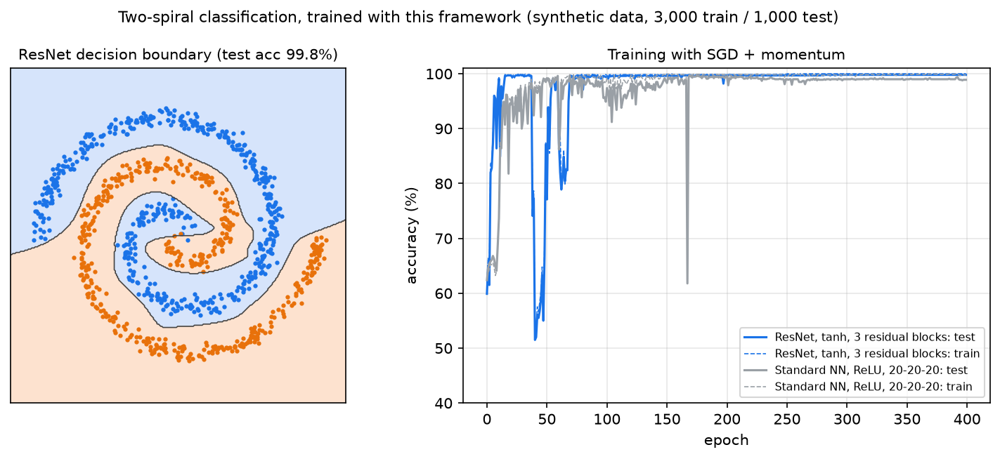
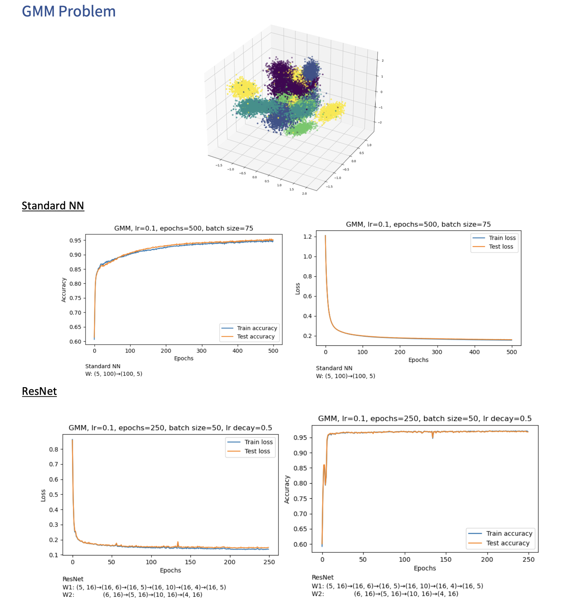
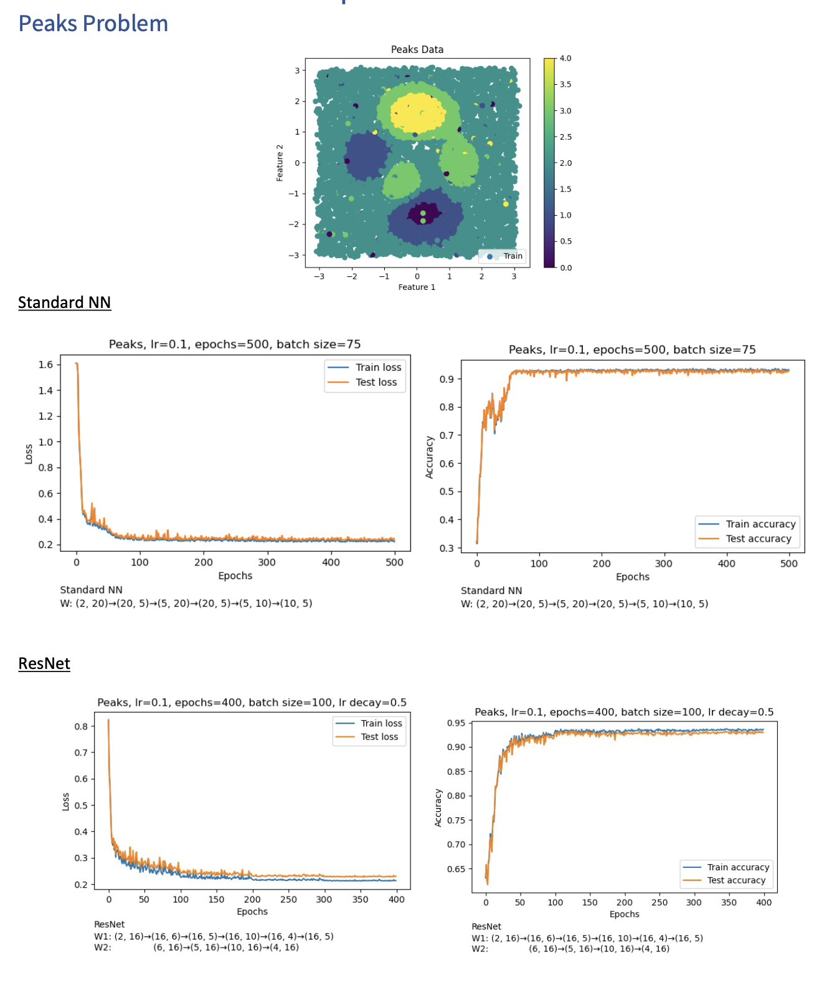

# Neural Network Framework from Scratch

A neural network framework written from first principles in NumPy: forward pass, backpropagation, SGD with momentum, fully connected and ResNet-style residual blocks. No autograd and no deep learning library. Every derivative was derived by hand, written as vectorized matrix operations, and checked numerically with gradient and Jacobian-transpose tests. Built as part of the Scientific Computing course at Ben-Gurion University (BSc, data science track).

**Key result:** the analytic gradients match a Taylor expansion of the loss through the full network, for both architectures. Halving the step size cuts the first-order error by 4x (the expected O(ε²)) while the zero-order error only halves (O(ε)). On the course datasets the trained networks reach about 95% test accuracy on GMM (standard network) and about 97% with ResNet blocks, and about 93% on Peaks (read off the training curves below).



*Generated by running `GradientTest.gradient_test_FC_nn()` and `GradientTest.gradient_test_ResNet_nn()` from `nn.py` on random inputs.*



*Trained with this framework on a synthetic two-spiral dataset (3,000 train / 1,000 test points, not one of the course datasets). The ResNet with tanh and 3 residual blocks reaches 99.8% test accuracy and the standard 20-20-20 ReLU network reaches 98.9%. The dips are real: plain SGD with momentum and a fixed step size is not smooth. Reproduce with `examples/train_spiral.py` and `examples/plot_spiral.py`.*

---

## What's inside

| File | Contents |
|------|----------|
| `main.py` | Softmax cross-entropy loss and its gradients with respect to weights and inputs, gradient tests, plain SGD and SGD with momentum, a least-squares sanity check |
| `nn.py` | The `NeuralNetwork` class (standard and ResNet), per-layer Jacobians, Jacobian-transpose tests, full-network gradient tests, training and plotting helpers |

## Architecture

Each standard layer computes

$$x^{(l+1)} = \sigma(W^{(l)} x^{(l)} + b^{(l)})$$

and each residual layer adds a skip connection:

$$x^{(l+1)} = x^{(l)} + W_2^{(l)} \sigma(W_1^{(l)} x^{(l)} + b_1^{(l)})$$

The last layer is a linear map followed by softmax. Activations: `tanh` and `relu`.

Backpropagation runs layer by layer from the loss, multiplying by the transposed Jacobian of each layer with respect to its input, weights and bias. All of it is matrix operations over a whole mini-batch, with no per-sample loops.

## How correctness was verified

1. **Loss gradient test.** For a random direction `d`, compare `|F(θ + εd) − F(θ)|` (should shrink linearly) with `|F(θ + εd) − F(θ) − ε dᵀ∇F|` (should shrink quadratically).
2. **Jacobian-transpose tests.** The same check applied to each layer on its own, for `W`, `x` and `b`, in both the standard and the ResNet layer.
3. **Full-network test.** Perturb every weight and bias in the network at once and check that backprop's gradient predicts the change in loss to second order. This is the figure above.

## Usage

```sh
pip install numpy matplotlib scipy
```

```python
from nn import NeuralNetwork

# 2 input features, hidden layers of 20, 5, 20, 5 units, 5 classes
net = NeuralNetwork(2, [20, 5, 20, 5], 5, "relu", ResNet=False)
net.fit(X, y, alpha=0.1, iterations=500, delta=1e-4, batch_size=75)  # X: (features, samples)
pred = net.predict(X_test)
```

The training scripts expect the course datasets (`SwissRollData.mat`, `GMMData.mat`, `PeaksData.mat`) in `./datasets/`. They are not included in this repository.

## Results on the course datasets

Experiments swept batch size and learning rate. The best settings were batch size 50 to 100 with learning rate 0.1 to 0.5, and halving the learning rate every 100 epochs (`alpha_decay=0.5`) was used for the ResNet runs.

**GMM (5D, 5 classes)**



**Peaks (2D, 5 classes)**



## References

1. Scientific Computing course, Ben-Gurion University
2. Goodfellow, Bengio and Courville, *Deep Learning*
